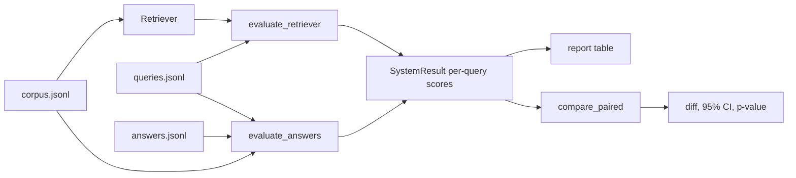

# ragscore

A small toolkit for evaluating retrieval and RAG systems, and for checking whether one system
really beats another or just got lucky on a handful of queries. I wrote it because comparing two
retrievers on ten queries and quoting two decimals is easy to do and easy to get wrong.

It has no runtime dependencies. Everything is standard library, typed and tested.

## What it measures

**Retrieval** (given ranked document ids and labelled relevant documents):

- hit@k, precision@k, recall@k
- MRR and average precision
- nDCG@k with graded relevance

**Answers** (given generated answers, the passages used and optional reference answers):

- exact match and token F1 against a reference
- groundedness: how many of the answer's content words appear in the retrieved context
- citation precision and recall for answers that cite sources like `[d3]`

**Comparison**: a paired bootstrap confidence interval and a sign-flip permutation p-value for the
difference between two systems on the same queries.

## Architecture



## Setup

```bash
uv sync
uv run pytest
```

## Usage

Evaluate a built-in reference retriever on the example data and keep the per-query scores:

```bash
uv run ragscore eval --corpus examples/corpus.jsonl --queries examples/queries.jsonl \
  --retriever bm25 --k 1,3,5 --out bm25.json
uv run ragscore eval --corpus examples/corpus.jsonl --queries examples/queries.jsonl \
  --retriever term_overlap --k 1,3,5 --out overlap.json
```

Test whether the difference is real:

```bash
uv run ragscore compare bm25.json overlap.json --metric ndcg@3
```

Score generated answers (one JSON object per line with `query_id`, `answer` and the ids of the
`retrieved` passages):

```bash
uv run ragscore answers --corpus examples/corpus.jsonl --queries examples/queries.jsonl \
  --answers my_answers.jsonl --name my-rag
```

To evaluate your own retriever, implement the two-line `Retriever` protocol and pass it to
`evaluate_retriever`:

```python
from pathlib import Path

from ragscore.dataset import load_queries
from ragscore.evaluate import evaluate_retriever


class MyRetriever:
    name = "my-retriever"

    def search(self, query: str, k: int) -> list[str]:
        """Return up to k document ids, best first."""
        raise NotImplementedError


result = evaluate_retriever(MyRetriever(), load_queries(Path("queries.jsonl")), ks=(1, 5, 10))
print(result.mean("ndcg@5"))
```

## Data format

`corpus.jsonl`: `{"id": "d1", "text": "..."}`

`queries.jsonl`: `{"id": "q1", "text": "...", "relevant": ["d1"], "reference": "optional"}`.
`relevant` may also be a mapping from document id to a graded gain, for example `{"d1": 2, "d4": 1}`.

## Design notes

- **Per-query scores are the unit of storage**, not averages. Significance testing needs the
  paired values, and averages cannot be re-analysed later.
- **The bootstrap resamples queries, not individual scores**, so the pairing between the two
  systems is kept. The p-value comes from randomly flipping the sign of each query's difference,
  which makes no distributional assumption.
- **Groundedness is a lexical proxy.** It flags answers that use words absent from the context,
  but it cannot catch a wrong claim built from context words. Treat it as a cheap smoke test and
  use a judge model or human review for real faithfulness claims.
- **With few queries the intervals are wide, and they should be.** The example set has ten
  queries so that the repo stays readable, not because ten is enough for a real conclusion.
- The BM25 implementation is here to give the evaluator something real to measure. It is not tuned
  or optimised.

## Tests

```bash
uv run ruff format --check . && uv run ruff check . && uv run mypy src && uv run pytest
```
